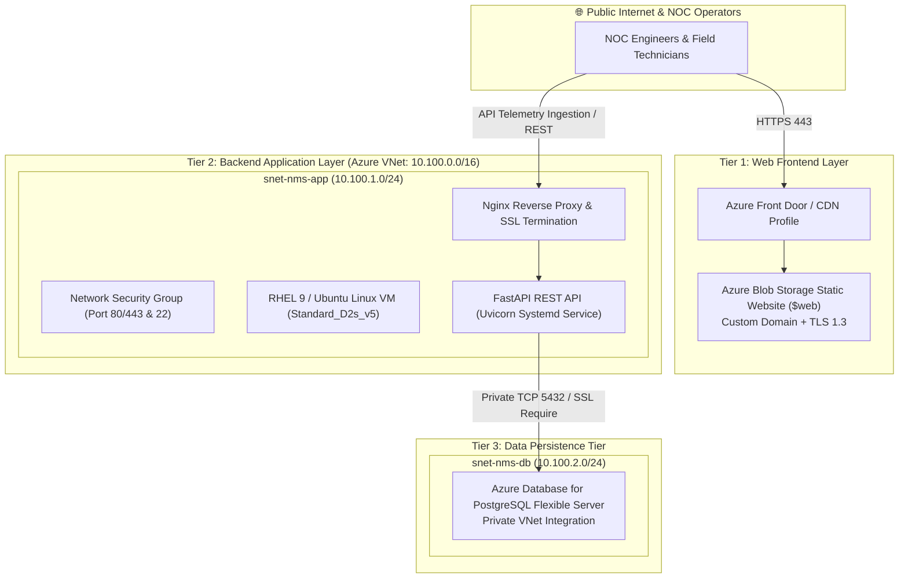

# 📡 Telecom Network Management System (NMS) on Microsoft Azure

[](https://azure.microsoft.com/)
[](https://fastapi.tiangolo.com/)
[](https://www.postgresql.org/)
[](https://nginx.org/)
[](https://www.kernel.org/)
[](https://www.terraform.io/)

An enterprise-grade **Telecom Network Operations Center (NOC) & Fault Management Platform** designed to monitor, ingest, and triage real-time telemetry and alarms across 2G, 3G, 4G-LTE, and 5G-NR Base Transceiver Stations (BTS / eNodeB / gNodeB).

Architected and engineered by **Osama Khalil** (Senior DevOps & Telecom Cloud Solutions Engineer) based on enterprise telecom deployments across Africa (Airtel / Huawei) and modern Azure cloud infrastructure.

---

## 🏛️ 3-Tier Cloud Architecture



---

## ✨ Features

- **Real-Time Fault Management (FM)**: Ingests critical, major, minor, and warning alarm events (VSWR degradation, AC mains power failure, optical SFP transceiver temperature anomalies).
- **Cell Site Inventory (CM)**: Tracks 2G/3G/4G/5G cell sites, regional hubs (Kenya, Zambia, Malawi, Namibia), management IPs, GPS coordinates, and operational state.
- **RESTful API**: Fast and asynchronous endpoints built with FastAPI, automatic OpenAPI/Swagger interactive documentation (`/docs`), and Pydantic validation.
- **Production Systemd Service**: Hardened Linux daemon (`nms-api.service`) with auto-restart, unprivileged execution (`nmsadmin`), and isolation.
- **High-Performance Nginx Proxy**: Configured with gzip compression, security headers (CSP, HSTS, X-Frame-Options), and burst rate limiting.
- **Database Engine**: Azure Database for PostgreSQL Flexible Server with private subnet integration and connection pooling.

---

## 📂 Repository Structure

```
.
├── backend/
│   ├── main.py                  # Application entry point & router setup
│   ├── database.py              # SQLAlchemy connection & session manager
│   ├── models.py                # Database models (CellSite, Alarm, Telemetry)
│   ├── schemas.py               # Pydantic request/response validation
│   ├── requirements.txt         # Python dependencies
│   ├── nms-api.service          # Production systemd unit file
│   └── routers/
│       ├── health.py            # /healthz and /readyz probes
│       ├── sites.py             # /api/v1/sites endpoints
│       └── alarms.py            # /api/v1/alarms endpoints
├── frontend/
│   ├── index.html               # Dark-mode NOC Operations Dashboard
│   ├── styles.css               # Telecom telemetry styles & KPI styling
│   └── app.js                   # Live event polling & alarm acknowledgment
├── nginx/
│   └── nginx.conf               # Production Nginx reverse proxy configuration
├── scripts/
│   └── deploy.sh                # End-to-end VM automated deployment script
├── tests/
│   └── test_api.py              # Pytest unit & integration test suite
└── README.md
```

---

## 🚀 Quickstart & Local Execution

### 1. Run Backend Locally
```bash
cd backend
python -m venv venv
source venv/bin/activate  # On Windows: .\venv\Scripts\activate
pip install -r requirements.txt

# Start FastAPI development server
uvicorn main:app --reload --port 8000
```
- Open Swagger UI: [http://localhost:8000/docs](http://localhost:8000/docs)
- Check health: [http://localhost:8000/healthz](http://localhost:8000/healthz)

### 2. Run Test Suite
```bash
pytest tests/ -v
```

### 3. Deploy to Linux Virtual Machine
```bash
chmod +x scripts/deploy.sh
sudo ./scripts/deploy.sh
```

---

## 🔐 Environment Variables

| Variable | Description | Default |
|---|---|---|
| `DATABASE_URL` | PostgreSQL or SQLite connection string | `sqlite:///./telecom_nms_local.db` |
| `PG_SSLMODE` | PostgreSQL SSL enforcement mode | `require` |
| `APP_ENV` | Application environment (`dev`, `staging`, `production`) | `production` |

---

## 👨‍💻 Author

**Osama Khalil**
- **Role:** Senior DevOps Engineer | Microsoft Azure | Terraform | CI/CD | Linux
- **GitHub:** [@khalilosam](https://github.com/khalilosam)
- **LinkedIn:** [linkedin.com/in/osama-khalil-20525227](https://www.linkedin.com/in/osama-khalil-20525227/)
